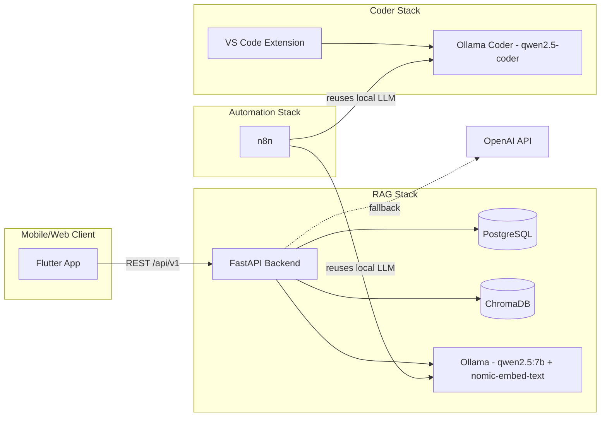

# AI School Assistant

A local-first school assistant platform combining **Retrieval-Augmented Generation (RAG)**, a **local LLM coding assistant** for VS Code, and an **n8n-powered AI Code Review automation** — all running on self-hosted Ollama models with an OpenAI fallback.

Built with `FastAPI`, `SQLAlchemy`, `PostgreSQL`, `Ollama`, `ChromaDB`, `Flutter`, and `n8n`.


---

## Overview

This repo contains three related but independently deployable systems:

| # | System | Purpose | Compose file |
|---|--------|---------|---------------|
| 1 | **RAG School Assistant** | Student/faculty/admin chat assistant with document-grounded answers, schedules, and announcements | `docker-compose.yml` |
| 2 | **Ollama Coder** | Local Qwen2.5-Coder models served for a VS Code coding extension | `docker/docker-compose.coder.yml` |
| 3 | **AI Code Review Assistant** | n8n workflow automation that reuses the local Ollama LLM to review code (e.g. on PRs/webhooks) | `docker/docker-compose.n8n.yml` |

Each stack can run standalone or together — the coder and n8n stacks are intentionally decoupled from the main RAG stack so they can be started only when needed.

---

## Architecture



- The **RAG backend** talks to Ollama for chat + embeddings, with ChromaDB as the vector store and Postgres for relational data (users, schedules, chat history).
- If Ollama is unreachable or a heavier model is preferred, the backend can switch to **OpenAI** for both chat and embeddings via a provider-based service layer — no code changes required, just env vars.
- The **coder stack** runs a separate Ollama instance on its own port (`11435`) so VS Code coding requests never compete with the school assistant's inference load.
- **n8n** reuses the same local Ollama models (either instance) to power an AI Code Review Assistant workflow, triggered via webhook (e.g. from GitHub PRs through an ngrok tunnel during development).

---

## Repository structure

```
ai_school_assistant/
├── backend/                              # FastAPI REST API (RAG, auth, schedules, documents)
├── data/                                 # RAG document storage / ingestion working data
├── mobile/                               # Flutter app (Riverpod MVVM)
├── website/                              # Web frontend
├── docker/
│   ├── docker-compose.coder.yml          # Standalone Ollama instance for VS Code coding extension
│   └── docker-compose.n8n.yml            # n8n automation (AI Code Review Assistant)
├── docs/
│   ├── architecture.png                  # Architecture diagram export
│   └── screenshots/                      # App / chat UI screenshots
├── docker-compose.yml                    # Core stack: backend, postgres, ollama, chromadb (stays at root)
├── .env.example                          # Template for required environment variables
├── .gitignore
├── LICENSE
└── README.md
```

> The core stack's `docker-compose.yml` stays at the repo root so `docker compose up -d` works with zero flags. The coder and n8n stacks already require an explicit `-f` flag to run, so moving them into `docker/` tidies the root without changing how they're invoked.

---

## 1. RAG School Assistant (core stack)

### Features
- JWT auth with `student`, `faculty`, and `admin` roles
- Admin-only document upload for `PDF`, `DOCX`, `TXT`
- Local RAG chat flow with citations and chat history
- SQL-backed student schedule retrieval
- Seeded announcements and demo users
- Flutter mobile shell: chat, schedule, document management, voice hooks

### Services

| Service | Purpose | Port |
|---|---|---|
| backend | FastAPI REST API | 9000 |
| postgres | Relational data | 5432 |
| ollama | Local LLM runtime | 11434 |
| chromadb | Vector storage | 9001 |

### Quick start

```bash
cd ai_school_assistant
cp .env.example backend/.env   # fill in real values, never commit this file
docker compose build
docker compose up -d
```

`ollama-init` pulls `qwen2.5:7b` and `nomic-embed-text` on first run (~5 GB, one-time — cached in the `ollama_data` volume).

```bash
# watch model download progress
docker compose logs -f ollama-init

# health check
curl http://localhost:9000/health
```

If `curl` returns `Empty reply from server`, the backend container likely crashed on boot:

```bash
docker compose ps
docker compose logs backend
```

If you changed `backend/requirements.txt` or the `Dockerfile`:

```bash
docker compose down
docker compose build --no-cache backend
docker compose up -d
```

### Local backend development (no Docker)

```bash
cd backend
pip install -r requirements.txt
```

`backend/.env` for SQLite dev mode:

```env
USE_SQLITE_FOR_DEV=true
SQLITE_DATABASE_URL=sqlite:///./school_assistant.db
PREWARM_EMBEDDING_MODEL=true   # optional: load embedding model at startup instead of first upload
```

```bash
uvicorn app.main:app --reload --port 9000
alembic upgrade head   # run migrations
pytest                 # run tests
```

### LLM / embedding provider switching

The backend isolates LLM and embedding access behind a provider-based service layer, so you can switch between **local Ollama** and **OpenAI** with env vars only — useful when Ollama isn't reachable or you want higher-quality answers.

**Local Ollama mode:**

```env
LLM_PROVIDER=ollama
OLLAMA_BASE_URL=http://ollama:11434
OLLAMA_MODEL=qwen2.5:7b
EMBEDDING_PROVIDER=auto
OLLAMA_EMBEDDING_MODEL=nomic-embed-text
```

**OpenAI fallback mode:**

```env
LLM_PROVIDER=openai
OPENAI_API_KEY=your_api_key_here
OPENAI_MODEL=gpt-4.1-mini
EMBEDDING_PROVIDER=auto
OPENAI_EMBEDDING_MODEL=text-embedding-3-small
OPENAI_BASE_URL=https://api.openai.com/v1
OPENAI_TIMEOUT_SECONDS=60
```

**Manual sentence-transformers fallback (CPU-bound, no API needed):**

```env
EMBEDDING_PROVIDER=sentence_transformers
EMBEDDING_MODEL_NAME=BAAI/bge-m3
```

> If you switch embedding provider or model, delete existing uploads and re-upload — old document rows aren't automatically reindexed into the new collection layout (Chroma collections are keyed by provider + model to avoid mixed-dimension vector bugs).

### Document ingestion diagnostics

```bash
docker compose logs -f backend
```

Look for these progress lines:

- `Document ingestion started`
- `Document text extracted`
- `Document chunking complete`
- `Document embedding/upsert starting`
- `Chroma upsert complete`
- `Document ingestion completed`

Reading them:
- Fast extraction/chunking but slow `Chroma upsert complete` → CPU embedding is the bottleneck.
- `Document ingestion failed` → document moves to `failed`, reason shown in the app.
- A `.txt` going `ready` quickly while a PDF is slow is expected — the PDF workload is just heavier, not a broken pipeline.

### Seeded accounts (local dev only — change before any real deployment)

- Admin: `admin@school.local` / `Admin123!`
- Student: `student@school.local` / `Student123!`

### Key API endpoints

- `POST /api/v1/auth/register`
- `POST /api/v1/auth/login`
- `GET /api/v1/auth/me`
- `POST /api/v1/chat`
- `GET /api/v1/chat/history`
- `POST /api/v1/documents`
- `GET /api/v1/documents`
- `GET /api/v1/students/me/schedule`
- `GET /api/v1/announcements`

### Ollama models (core stack)

| Model | Role | Size |
|---|---|---|
| `qwen2.5:7b` | Chat + RAG answering | ~4.7 GB |
| `nomic-embed-text` | Document embeddings | ~274 MB |

```bash
docker exec school_ollama ollama list
docker exec school_ollama ollama pull qwen2.5-coder:7b
docker exec school_ollama ollama rm qwen2.5-coder:7b
```

### Mobile (Flutter)

```bash
cd mobile
flutter pub get
flutter run --dart-define=API_BASE_URL=http://10.0.2.2:9000/api/v1
```

| Target | `API_BASE_URL` |
|---|---|
| Android emulator | `http://10.0.2.2:9000/api/v1` |
| Chrome/web (same machine) | `http://localhost:9000/api/v1` |
| Desktop / iOS simulator (same machine) | `http://localhost:9000/api/v1` |
| Physical Android device (same LAN) | `http://<your-pc-lan-ip>:9000/api/v1` |

```bash
flutter run -d chrome --dart-define=API_BASE_URL=http://localhost:9000/api/v1
flutter run -d emulator-5554 --dart-define=API_BASE_URL=http://10.0.2.2:9000/api/v1
```

**Building an APK for a physical device:**

```bash
flutter build apk --dart-define=API_BASE_URL=http://192.168.254.143:9000/api/v1
```

- `API_BASE_URL` must match the backend machine's **current** LAN IP — `localhost`/`10.0.2.2` won't work in an installed APK.
- Rebuild the APK whenever your Wi-Fi/router/hotspot changes your PC's IP.
- Before testing login, confirm `http://<your-pc-lan-ip>:9000/health` returns `{"status":"ok"}` from the phone's browser.

**Physical-device troubleshooting checklist:**
- APK built with the correct current IP (not a stale one)
- Phone and backend machine on the same LAN/Wi-Fi
- Backend reachable from the phone browser at `/health`
- Backend listening on the LAN interface, not just `localhost`
- Host firewall isn't blocking inbound traffic on port `9000`

> CORS doesn't affect the installed Android APK — it only matters for web builds, not native requests.

---

## 2. Ollama Coder — local LLM for a VS Code extension

A second, isolated Ollama instance dedicated to code completion/chat inside VS Code, kept separate from the school assistant's Ollama instance so the two workloads don't compete for resources.

```bash
docker compose -f docker/docker-compose.coder.yml up -d
```

| Service | Purpose | Port |
|---|---|---|
| ollama-coder | Local Ollama instance for coding models | 11435 |
| ollama-coder-init | One-time pull of coder models, exits after | — |

Models pulled on first run:
- `qwen2.5-coder:1.5b` (fast, lightweight completions)
- `qwen2.5-coder:7b` (higher quality, heavier)

Point your VS Code Ollama/Continue-style extension at `http://localhost:11435`.

---

## 3. AI Code Review Assistant — n8n automation

An n8n workflow that reuses the local Ollama LLM (either the core or coder instance) to automatically review code — e.g. triggered by a GitHub webhook on pull requests.

```bash
docker compose -f docker/docker-compose.n8n.yml up -d
```

Open n8n at `http://localhost:5678`.

**Environment notes:**
- `extra_hosts: host.docker.internal:host-gateway` lets the n8n container reach Ollama running on the host (or another container) without extra networking setup.
- `WEBHOOK_URL` should point to a public tunnel (e.g. ngrok) only while developing/testing incoming webhooks (like GitHub PR events). **Do not commit a real, live tunnel URL** — use a placeholder in version control and set the real one via `.env` or your ngrok config locally.
- `EXECUTIONS_TIMEOUT` is set generously (900s) since local LLM inference on CPU can be slow for larger diffs.

---

## Environment variables

Copy the template and fill in real values — **never commit `.env` files**:

```bash
cp .env.example backend/.env
```

See `.env.example` for the full list (database credentials, Ollama URLs, OpenAI fallback keys, n8n webhook URL).

---

## Security checklist before pushing publicly

- [ ] No real `.env` files committed (check `git log` for accidental history, not just the current tree)
- [ ] `WEBHOOK_URL` in `docker-compose.n8n.yml` is a placeholder, not a live tunnel
- [ ] Default Postgres credentials (`school_user`/`school_pass`) are documented as **dev-only**, not used anywhere real
- [ ] Any API key that was ever shared in chat, logs, or screenshots has been rotated
- [ ] Seeded demo account passwords are clearly marked as local-dev-only

---

## Design notes

- The vector store sits behind a service interface so `ChromaDB` can be swapped for `Qdrant` later with minimal changes.
- LLM and embedding access are each behind provider-based service layers, keeping Ollama/OpenAI swaps localized to config.
- Chroma collections are derived from `embedding_provider + model` to avoid mixed-dimension vector bugs when switching providers.
- `ollama-init` runs once on first `docker compose up` and exits — no ongoing resource cost after that.
- Background document ingestion currently uses FastAPI background tasks (MVP-level; a task queue is a natural next step for scale).

## Roadmap ideas

- [ ] Swap ChromaDB → Qdrant for production-scale vector search
- [ ] Move ingestion from FastAPI background tasks to a proper task queue (e.g. Celery/RQ)
- [ ] Wire the n8n Code Review Assistant to GitHub Actions instead of ngrok for production use
- [ ] Add CI (lint + test) via GitHub Actions

## License

MIT — see `LICENSE`.
